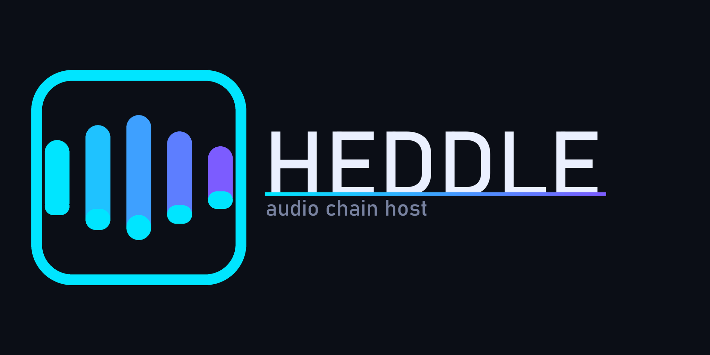

# Heddle

**Heddle** — a C++ audio-plugin chain host: load VST 2 / VST 3 plugins into an
ordered processing chain, drive every parameter live over **OSC**, describe the
whole setup in a small **JSON** config, and run it offline from a CLI.

> *Heddle*: the wire or loop in a loom's heddle frame that the warp threads
> pass through — raising and lowering alternate threads opens the **shed**,
> the gap the shuttle weaves through. Here, each slot is a heddle: it lifts
> one plugin's signal into the chain's path, and the chain is the shed.



---

## Status

| Layer | What it is | State |
|---|---|---|
| `core/` | Platform-agnostic C++17 library: param model, chain, JSON config, OSC wire + addressing, UDP transport, time-series params (static or curve) | **building & tested** (60/60 test cases, 1701 assertions) |
| `host/` | JUCE-based VST3 wrapper backend + `heddle_smoke` introspection CLI + `heddle-render` offline audio→audio CLI | **building & CI-tested** |

Progress is tracked in [STATUS.md](STATUS.md).

## What Heddle does

1. **Chains VST2/3 plugins** in an ordered processing graph.
2. **Loads per-plugin / per-param default values from JSON** — one config file
   describes the whole rig, versionable and diff-able.
3. **Live-updates the chain** when any param changes at runtime (hot-apply:
   unchanged plugins are never reloaded).
4. **Queries all params** from each loaded plugin (normalized surface with
   name, id, range, steps, kind).
5. **Exposes dynamic per-param control over OSC** — set by *name* or by *id*,
   reset per-slot or global, re-load config by path or JSON blob, and receive
   `/change/...` pushes when a plugin changes its own params.

Architecture decision (user-directed): the **inner VST wrapper only describes
the param interface**; the **outer app owns the OSC transport**. The core
library never links a plugin SDK.

## Getting a build

This repo publishes **source only** — no prebuilt binaries (the host layer
links JUCE, which is dual-licensed AGPL-3.0 / commercial; see [License](#license)
— so build from source:

**Windows, one-shot (core + host + all tests):**

```powershell
pwsh scripts\build-all.ps1
```

Binaries land in `build/` (core, MSYS2) and `build-msvc/host/Release/`
(host, MSVC): `heddle-host.exe`, `heddle-render.exe`, `heddle_smoke.exe` and the
`HeddleSmokePlugin.vst3` test plugin.

Or build just the render CLI by hand:

```sh
./heddle-render input.wav chain.json output.wav --bits 16
```

That's the whole UX: one input WAV, one JSON config (see
[examples/chain.json](examples/chain.json) for the shape — each slot names a
VST3 file and its `params`), one output WAV at the input's sample rate.

> The plugin paths in the config point at *your* VST3 files — Heddle ships
> without any third-party plugins.

## Building the core (local)

Requires CMake ≥ 3.16 and a C++17 compiler (tested: MSYS2 ucrt64 g++ 16, cmake 4.4).

```sh
cmake -S . -B build -DCMAKE_BUILD_TYPE=Release
cmake --build build -j4
cd build && ctest --output-on-failure
```

Third-party headers (`nlohmann/json`, `doctest`) are vendored under
`third_party/` — no network access needed to build.

CI runs the same steps on GitHub Actions (see `.github/workflows/ci.yml`).

## Building the host + render CLI

The JUCE host layer is opt-in (it fetches JUCE 8.0.4 at configure time, so
core-only builds stay network-free):

```sh
cmake -S . -B build -DCMAKE_BUILD_TYPE=Release -DHEDDLE_BUILD_HOST=ON
cmake --build build -j4 --target heddle_smoke heddle_smoke_plugin_VST3 heddle-render
```

> JUCE 8 dropped MinGW, so the host layer builds on MSVC (Windows), AppleClang
> (macOS) and Clang/GCC (Linux) — CI covers all three. The core library
> still builds on MSYS2 MinGW.

## Rendering offline (audio → audio)

`heddle-render` reads a WAV, runs it through the chain described by a JSON
config, and writes a WAV. No resampling — the output keeps the input's sample
rate (must be a standard 8k–384k rate) and no audio device is touched.

```sh
heddle-render input.wav chain.json output.wav [--bits 16|24|32] [--version]
```

- The chain comes from the config's `chain` array; each slot's `params`
  block is **pushed onto the live plugin instance**, so a config fully
  determines the render (deterministic, reproducible, diff-able).
- `--bits 16|24|32` picks the output bit depth (default **32 = 32-bit float
  WAV**, lossless for the float chain; 16/24 are plain integer conversion,
  no dither).
- Slots with `enabled: false` pass audio through untouched; an empty chain is
  a passthrough.
- Mono input is upmixed to stereo; output channel count is the widest slot's
  bus width.

The VST3 plugin path in the config is resolved relative to the current
working directory (absolute paths work too). See
[docs/CONFIG.md](docs/CONFIG.md) for the full schema and [examples/chain.json](examples/chain.json).

## Running the live host

`heddle-host` is the real-time side: it loads the same JSON config, runs the
plugin chain live, and exposes **every param over OSC** (UDP, default port
9001) — set by name or id, query, reset, hot-apply a new config, and receive
`/change/...` pushes. The full protocol is in [docs/OSC.md](docs/OSC.md).

```powershell
# live output (real audio device), OSC on :9001
.\build-msvc\host\Release\heddle-host.exe examples\chain.json

# headless (no audio device; software clock at the config's rate/block)
.\build-msvc\host\Release\heddle-host.exe examples\chain.json --audio null

# DAW-bridge mode: serve audio over the HeddleBridge VST3's shared-memory rings
.\build-msvc\host\Release\heddle-host.exe examples\chain.json --audio ring

# interactive slider window
.\build-msvc\host\Release\heddle-host.exe examples\chain.json --gui
```

| Flag | Meaning |
|---|---|
| `--audio system\|null\|ring` | real device (default) / software clock / DAW bridge rings |
| `--device NAME` | select the audio device |
| `--ring PREFIX` | ring names `PREFIX.in`/`PREFIX.out` (default `heddle.bridge.*`) |
| `--osc-port N` | override the OSC port (config `osc.port` is the default) |
| `--duration SECONDS` | exit 0 after N seconds |
| `--gui` | param-control slider window (off by default) |
| `--no-inblock` | legacy immediate-latch param sets (default is in-block, below) |
| `--substep N` | in-block curve segment size in samples (default 4) |

### VST structure of a chain

The config's `chain` array is the VST structure: an **ordered list of slots**,
each slot = one loaded plugin (a VST3 bundle path + optional class id), wired
in series — slot 0's output is slot 1's input, and so on. Inside a slot, the
plugin's own param surface is discovered at load time: every param becomes
addressable over OSC as `/chain/<slotId|index>/<paramName>` (set by name with
one float, by id with `int, float`), and is also listed in the config's
`params` block as its load-time value (static number or a curve object).
`enabled: false` keeps the slot's address alive but passes audio through
untouched. So a rig is fully described as: *which plugins, in what order,
with what starting values* — the rest of the surface (every remaining
param, all resets, hot-swaps) is reachable live over OSC or the `--gui`
window. The offline render CLI and the live host share the exact same
config, backend, and param model.

### Live automation (in-block curve scheduling)

In the default **in-block** mode every OSC set is a **waypoint**, not an
immediate latch: it is stamped ~2 blocks ahead (the block the audio thread
has not started yet — the DAW-equivalent of a parameter queue) and the audio
thread renders the block as a **sample-accurate sub-block staircase** (default
4 samples), interpolating between the paced waypoints. A burst of sets
therefore becomes a smooth curve, and a late set still bends the curve that
is still scheduled for the coming block. Each (slot, param) curve rides a
lock-free SPSC ring (512 waypoints deep — a controller can safely burst), and
only params under an *active* curve cost anything in the audio path.

`--no-inblock` restores the legacy behavior (each set latches immediately,
one value per set, no curve).

**Rate to aim for:** the critical rate for a block size B at 48 kHz is
**1 waypoint per block** (48000/B sets/s — 375/s @128, 94/s @512, 23/s
@2048). Below it the curve underruns (a block with no waypoint holds flat:
2.5–7.1 % deviation in the 0.1 set/block measurements); at and above it the
error is a flat 0.8–1.6 % floor set by waypoint pacing + block-boundary
quantization, independent of rate (R² ≥ 0.9994, 18-config sweep, 0 samples
lost / 0 sets dropped). Full methodology + numbers:
[docs/PERFORMANCE.md](docs/PERFORMANCE.md) → *In-block curve scheduling*.
The host's legacy per-block curve tick (config `curve:` keyframes) matches
this dynamically: it runs at **2 × sampleRate / block size** (2 ticks per
block, re-scaled when the device reports its real block size) and only ever
pushes params whose curve still has an upcoming keyframe — a rig full of
hundreds of static params costs nothing.

## Layout

```
heddle/
├── core/
│   ├── include/heddle/
│   │   ├── param.hpp      # Param / ParamSet model
│   │   ├── curve.hpp      # time-series param (static float or curve)
│   │   ├── chain.hpp      # Chain + IPluginBackend
│   │   ├── config.hpp     # JSON config parse/dump/merge
│   │   ├── osc.hpp        # OSC 1.0 wire codec + /chain addressing
│   │   └── osc_io.hpp     # UDP OSC transport (source tracking)
│   ├── src/               # implementations
│   ├── tests/             # targeted doctest suites
│   └── tools/             # heddle_ring_latency, heddle_osc_perf benchmarks
├── host/                  # JUCE backend + heddle_smoke + heddle-render (opt-in)
│   └── src/               # host_main.cpp (live host), osc_ramp_test.cpp, osc_perf_host.cpp, ...
├── docs/                  # CONFIG.md, OSC.md, ARCHITECTURE.md, ALIGNMENT.md, PERFORMANCE.md
├── examples/chain.json    # example rig config
├── assets/logo/           # banner, avatar, mark
└── third_party/           # nlohmann/json.hpp, doctest.h (vendored)
```

## Documentation

- [docs/ARCHITECTURE.md](docs/ARCHITECTURE.md) — layering, backend contract, data flow
- [docs/CONFIG.md](docs/CONFIG.md) — JSON schema + merge semantics
- [docs/OSC.md](docs/OSC.md) — full OSC protocol reference
- [docs/ALIGNMENT.md](docs/ALIGNMENT.md) — solution ↔ use-case fit analysis
- [docs/PERFORMANCE.md](docs/PERFORMANCE.md) — OSC/ring performance results + harness

## Prior art

Heddle is informed by (and deliberately distinct from):

- **ReaPlugga** (ReaPlugga/ReaPlugga on GitHub) — hosts VST2 plugins in a
  ReWire/ASIO context; no param-level OSC.
- **JUCE `AudioPluginHost` / HostPluginDemo** — reference hosting; Heddle builds
  the host layer on JUCE hosting and adds the chain+OSC+config layer above it.
- **getdunne/juce-plugin-wrapper** — minimal JUCE VST wrapper as a starting
  point for the backend contract.

## License

Heddle's own source is licensed under the **Heddle License** (see [LICENSE](LICENSE)):
the project owner (Mykhailo) may use it for **any purpose, including commercial**,
while everyone else may use, modify, and distribute it **for non-commercial
purposes only** (personal, academic, research). Commercial use by any other
party requires a written commercial license from the owner
(neworldemancer@gmail.com). The plugin ecosystem is what you bring in — Heddle
neither bundles nor distributes any third-party plugin.

**Code-only policy.** This repo publishes **source only**: no prebuilt
binaries are committed, released, or kept on GitHub. Building is done locally
(`scripts/build-all.ps1` on Windows) or on demand via the manual
`build` workflow (`.github/workflows/build.yml`), whose artifacts are pulled
down locally and then deleted from GitHub. (The earlier `heddle-render` release
artifacts, v0.1.0–v0.1.5, have been removed from GitHub for the reason below.)

**Why no binaries.** The host layer links two dependencies whose *binary*
distribution is restricted:
- **JUCE 8.0.4** — dual-licensed **AGPL-3.0 / commercial**. JUCE is fetched at
  build time (`FetchContent`, pinned by SHA256) and never vendored, so the
  *source* repo keeps the plain Heddle License. Distributing a *built* host
  binary legally requires either a commercial JUCE licence or an AGPL-3.0
  relicense of the
  host layer with a corresponding-source offer.
- **VST3 SDK** (Steinberg) — proprietary (signed agreement) or **GPLv3**.

Core-only use stays under the plain Heddle License. If Heddle is ever
distributed commercially as prebuilt binaries, the plan is to buy the JUCE
commercial licence (the Heddle License already permits the owner commercial
use); until then the project stays code-only.
